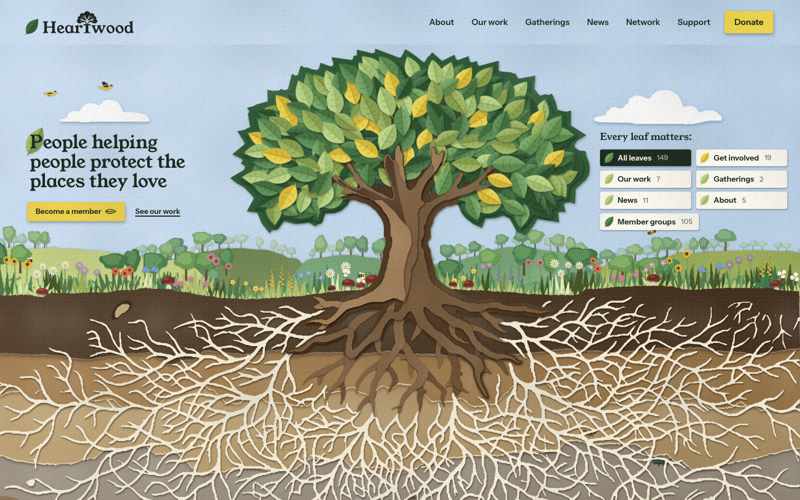
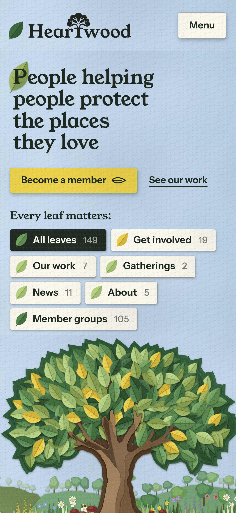
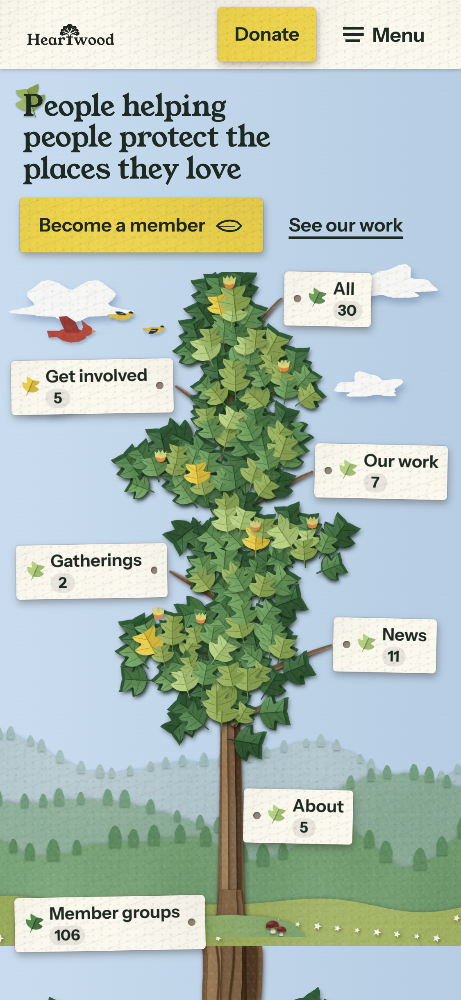
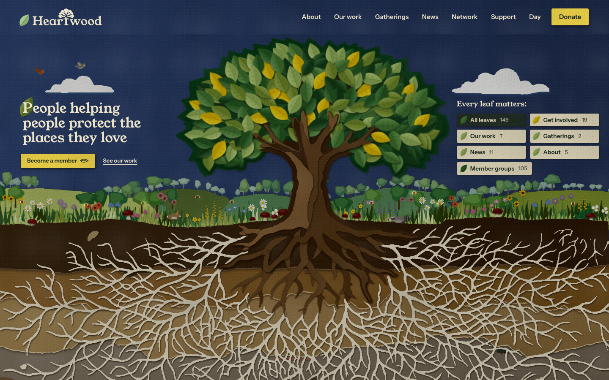
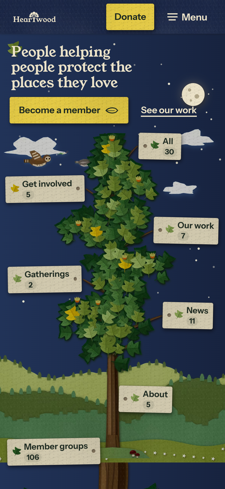

# Day, night and phone visual review

Before: upstream commit 798df873e7c3365db30d4c10107bbede166ea8dd.
After: the source in this change, built with Node 22.23.3 and Python 3.13.
All captures use Chrome 154.0.8037.99 on macOS, with loaded fonts and the real desktop leaf introduction completed. Screenshots are unedited.

Desktop: 1440 by 900 CSS pixels, density 1. Phone: 375 by 812 CSS pixels, density 3, touch emulation. The phone layout adapts the site author's existing cut-paper design and assets for a vertical screen; these images do not establish physical-device performance. The phone tree retains 200 leaves with its paper faces enlarged by 18 percent.

The site author created the original design, artwork and assets. The project direction added the optional “taste you didn't ask for” additions. This change concerns rendering performance and mode adaptations.

| View | Before | After |
|---|---|---|
| Desktop day |  |  |
| Phone day |  |  |
| Night | No previous designed night scene in this baseline |   |

The after pages passed 16 positive browser journeys covering mode selection, actual icon bodies, fonts, the transparent mycelium trim, filters, member search, navigation, dialog focus and Escape, phone touch previews, Back, rapid close/reopen, 200 percent text and reduced motion. The guarded run made no non-loopback requests and left no owned browser, process, listener or temporary resource behind.

Build and all 11 upstream delivery tests passed against a separate owned preview. These observations do not establish Safari, Firefox, physical iOS/Android or full performance acceptance.
